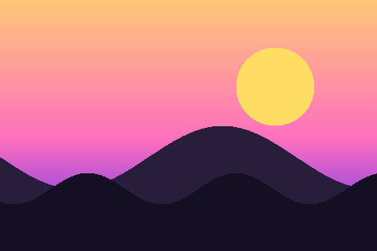
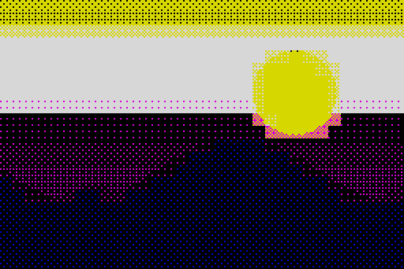
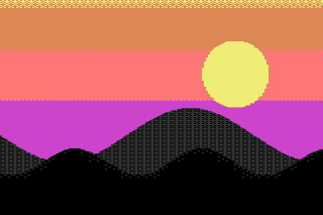
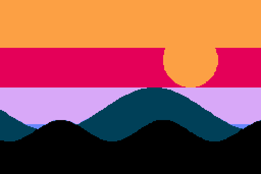
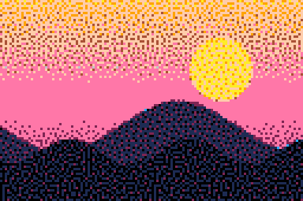
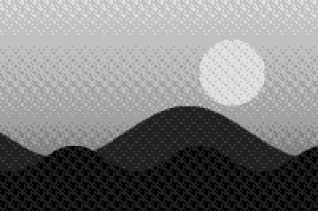
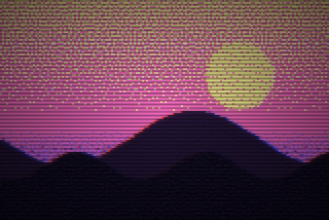
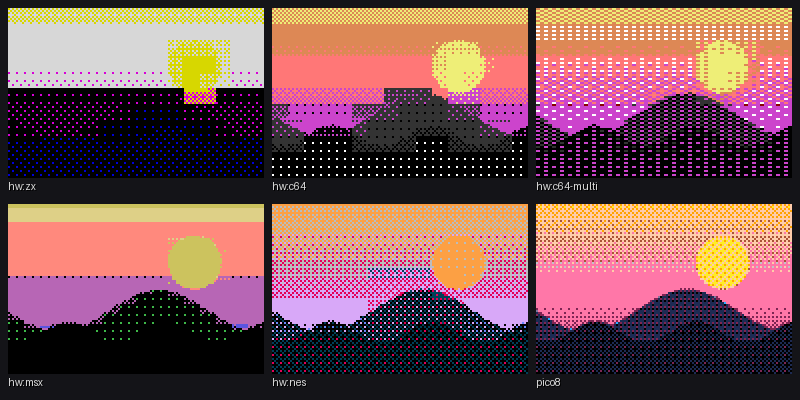
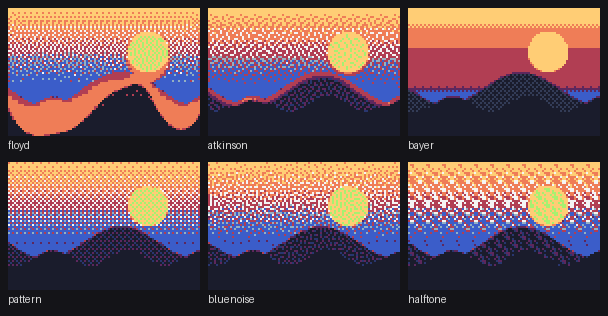

# PIXELATE

```
██████╗ ██╗██╗  ██╗███████╗██╗      █████╗ ████████╗███████╗
██╔══██╗██║╚██╗██╔╝██╔════╝██║     ██╔══██╗╚══██╔══╝██╔════╝
██████╔╝██║ ╚███╔╝ █████╗  ██║     ███████║   ██║   █████╗
██╔═══╝ ██║ ██╔██╗ ██╔══╝  ██║     ██╔══██║   ██║   ██╔══╝
██║     ██║██╔╝ ██╗███████╗███████╗██║  ██║   ██║   ███████╗
╚═╝     ╚═╝╚═╝  ╚═╝╚══════╝╚══════╝╚═╝  ╚═╝   ╚═╝   ╚══════╝
        retro pixel art from any image  ·  v3.0.0
```

[](https://www.python.org/downloads/)
[](LICENSE)
[](https://github.com/Sebby1770/pixelate/actions/workflows/ci.yml)
[](https://python-pillow.org/)

**PIXELATE Studio (web):** [https://sebby1770.github.io/pixelate/](https://sebby1770.github.io/pixelate/)

> Turn any image (or animated GIF) into authentic retro pixel art. PIXELATE goes beyond "quantize to a palette": it can emulate the **attribute clash** of real 8-bit hardware (ZX Spectrum, C64, MSX, NES), uses **palette-aware pattern dithering** (Knoll / blue noise / halftone), runs error diffusion **30–80× faster** than 2.x through cached lookup tables, and exports to PNG, GIF, **SVG, JSON and C headers**.

---

## Gallery

| Source | ZX Spectrum (clash) | C64 multicolor | NES sub-palettes |
|:---:|:---:|:---:|:---:|
|  |  |  |  |
| original | `--preset zx-loading-screen` | `--preset c64-demo` | `--preset nes-cart` |

| PICO-8 blue noise | Newsprint halftone | Vaporwave VHS | Game Boy |
|:---:|:---:|:---:|:---:|
|  |  |  |  |
| `--palette pico8 --dither bluenoise` | `--preset newsprint` | `--preset vaporwave-vhs` | `--palette gameboy` |

**Every hardware mode side by side** — `pixelate compare photo.jpg --palettes hw:zx,hw:c64,hw:c64-multi,hw:msx,hw:nes,pico8`



**Dithers** — error diffusion vs ordered vs the new pattern family:



---

## What's new in 3.0

- **Hardware modes** — `--hardware zx|c64|c64-multi|msx|nes` restricts every attribute cell to the colors the real machine allowed, searched exhaustively per cell (plus a shared background / four NES sub-palettes chosen globally), then dithers *inside* each cell. C64 multicolor uses true double-wide pixels.
- **Pattern dithering** — `pattern` (Thomas Knoll's algorithm over Bayer 8×8), `bluenoise` (void-and-cluster mask) and `halftone` (clustered dot). Palette-aware, so irregular retro palettes dither cleanly instead of banding.
- **Fast engine** — error diffusion runs on a padded scalar buffer with a cached 64³ nearest-palette table (`pixelate.lut`). Floyd–Steinberg at 512 px: **3.9 s → 0.12 s**; CIEDE2000 diffusion at 256 px: **3.1 s → 33 ms**.
- **Presets** — twelve one-flag looks (`--preset zx-loading-screen`, `mac-classic`, `arcade-crt`, `sprite`, …) plus your own JSON presets. Flags you type always win.
- **Exports** — `-o art.svg` (run-merged, crisp vector), `-o art.json` (indexed pixels + palette), `-o art.h` (C arrays for homebrew), `pixelate swatches` sheets.
- **New effects** — palette-locked `--outline`, `--grid`, `--chromatic`, `--color-bleed` (NTSC), `--curvature` (barrel CRT), `--cleanup` (orphan pixels).
- **Scale2x / Scale3x** — `--upscaler scale2x|scale3x|scale4x` smooths staircases without inventing colors.
- **14 new palettes** — Game Gear, Virtual Boy, Amstrad CPC, Teletext, DB32, CGA palette 0, 1-bit, SLSO8, Demichrome, Kirokaze, Ice Cream GB, Hollow, AYY4 (38 unique palettes total).
- **PIXELATE Studio** — the web lab rebuilt: worker-powered engine shared with the Python algorithms, hardware modes, presets, split before/after view, zoom, webcam, clipboard, share links, SVG/JSON/palette export.
- **Tooling** — ruff + mypy clean, CI on Python 3.9–3.14, node tests for the web engine, generated `web/data.json` kept in sync with the package.

See [CHANGELOG.md](CHANGELOG.md) for the full list.

## Install

```bash
git clone https://github.com/Sebby1770/pixelate.git
cd pixelate
pip install -e .
```

Dev / tests:

```bash
pip install -e ".[dev]"
pytest
ruff check . && mypy
node --test web/tests/
```

## Usage

### Convert an image

```bash
pixelate convert photo.jpg --palette gameboy --pixel-size 96 --dither floyd
pixelate convert photo.jpg --palette pico8 --dither bluenoise
pixelate convert photo.jpg --palette sweetie16 --dither pattern --upscaler scale2x
pixelate convert photo.jpg --colorspace ciede2000 --dither sierra3
```

### Hardware modes (attribute clash)

```bash
pixelate hardware                                   # list modes and their rules
pixelate convert photo.jpg --hardware zx            # 256 px, ink + paper per 8×8 cell
pixelate convert photo.jpg --hardware c64-multi --dither bayer
pixelate convert photo.jpg --hardware nes --dither none --report
```

| Mode | Machine | Cell | Colors / cell | Rules |
|------|---------|------|---------------|-------|
| `zx` | ZX Spectrum | 8×8 | 2 | ink + paper from the same BRIGHT bank |
| `c64` | Commodore 64 hires | 8×8 | 2 | any two of 16 |
| `c64-multi` | Commodore 64 multicolor | 4×8 (wide pixels) | 4 | shared background + 3 per cell |
| `msx` | MSX / TMS9918 Graphics II | 8×1 | 2 | two colors per line segment |
| `nes` | NES background | 16×16 | 4 | universal background + one of four 3-color sub-palettes |

`--hardware` overrides `--palette` and, unless you pass `--pixel-size`, uses the machine's native resolution. Any dither works — it just has to stay inside each cell's colors.

### Presets

```bash
pixelate presets
pixelate convert photo.jpg --preset mac-classic
pixelate convert photo.jpg --preset arcade-crt --pixel-size 200   # your flag wins
pixelate convert photo.jpg --presets-file my_looks.json --preset neon
```

Built in: `gameboy-camera`, `zx-loading-screen`, `c64-demo`, `nes-cart`, `msx-title`, `pico8-postcard`, `mac-classic`, `newsprint`, `vaporwave-vhs`, `arcade-crt`, `sprite`, `virtual-boy`.

A presets file is JSON: `{"neon": {"description": "…", "palette": "cyberpunk", "dither": "bluenoise", "crt": true}}` — keys are `pixelate_image` arguments.

### Effects

```bash
pixelate convert photo.jpg --palette nes --crt --phosphor --scanlines --curvature 0.06
pixelate convert photo.jpg --palette vaporwave --chromatic 2 --color-bleed 0.6
pixelate convert sprite.png --palette auto --colors 12 --cleanup 1 --outline 1 --upscaler scale3x --upscale 6
pixelate convert sprite.png --palette db16 --grid --upscale 8
```

Effect order: grid → CRT bloom → color bleed → RGB split → phosphor → scanlines → curvature.

### Export

```bash
pixelate convert photo.jpg --palette pico8 -o art.svg     # vector, one <rect> per color run
pixelate convert photo.jpg --palette pico8 -o art.json    # {"palette": [...], "pixels": [[...]]}
pixelate convert sprite.png --hardware nes -o sprite.h    # C header with palette + index arrays
pixelate swatches pico8 -o pico8.png                      # palette sheet (also hw:c64, .gpl, .hex)
```

### Compare

```bash
pixelate compare photo.jpg --palettes gameboy,nes,pico8,c64 -o compare.png
pixelate compare photo.jpg --palettes hw:zx,hw:c64,hw:msx,hw:nes --dither pattern
```

### Auto palette, custom palettes, extraction

```bash
pixelate convert photo.jpg --palette auto --colors 12 --seed 1
pixelate convert photo.jpg --palette-file my_colors.gpl
pixelate extract photo.jpg -o photo.gpl --colors 12
pixelate palettes --save-gpl pico8 -o pico8.gpl
```

### Animation, batch, spritesheets, ASCII

```bash
pixelate convert walk.gif --palette pico8 --pixel-size 64 -o walk_pixel.gif
pixelate batch ./photos -o ./out --preset pico8-postcard --jobs 4
pixelate sheet ./frames --cols 8 -o sheet.png --palette gameboy
pixelate ascii photo.jpg --width 120 --ramp blocks
```

Every convert option (presets and hardware modes included) also works for animations, batch and sheets.

## Dithers

| Name | Family | Look |
|------|--------|------|
| `none` | — | nearest color only |
| `floyd`, `atkinson`, `stucki`, `burkes`, `sierra`, `sierra3`, `sierra-lite`, `jjn` | error diffusion (serpentine) | organic noise; Atkinson keeps contrast |
| `bayer` | ordered threshold (`--bayer-size 2/4/8`) | classic crosshatch |
| `pattern` | Knoll pattern dither over Bayer 8×8 | clean, palette-aware crosshatch |
| `bluenoise` | Knoll pattern dither over blue noise | grain-free, no visible grid |
| `halftone` | Knoll pattern dither over clustered dots | newsprint / comic dots |

`pixelate dithers` prints this list from the CLI.

## Performance

Warm timings on a 1600×1200 source, PICO-8 palette, Apple Silicon:

| Pipeline | 2.5 | 3.0 |
|----------|----:|----:|
| Floyd–Steinberg, Lab, 256 px | 955 ms | 32 ms |
| Floyd–Steinberg, Lab, 512 px | 3,887 ms | 122 ms |
| Floyd–Steinberg, CIEDE2000, 256 px | 3,102 ms | 33 ms |
| Atkinson, Lab, 512 px | 3,819 ms | 158 ms |
| Blue-noise pattern, Lab, 512 px | — | 71 ms |

The LUT samples cell centers of a 64³ RGB cube, so diffusion can only pick a different color than an exact search within ~2 RGB units of a boundary between two palette colors. Plain quantization (`--dither none`) still uses the exact vectorized search. CIEDE2000 tables are exact for palettes up to 32 colors.

## CLI reference

```
pixelate convert IMAGE [OPTIONS]
  -p, --palette         built-in name or 'auto'
      --palette-file    .hex or .gpl path
      --colors / --extract-method / --seed     auto palette controls
  -s, --pixel-size      long side in art pixels (8–1024)
      --downscale       box (default) | lanczos | nearest
  -d, --dither          none | floyd | atkinson | bayer | stucki | burkes | sierra |
                        sierra3 | sierra-lite | jjn | pattern | bluenoise | halftone
      --bayer-size      2 | 4 | 8
      --colorspace      lab (default) | rgb | ciede2000
      --serpentine / --no-serpentine
  -u, --upscale         1–16          --upscaler   nearest | scale2x | scale3x | scale4x
      --scale           1–32 extra nearest scale
      --saturation / --contrast / --invert / --edges / --posterize N
      --hardware        zx | c64 | c64-multi | msx | nes   (attribute clash)
      --preset NAME     --presets-file FILE.json
      --outline N       --outline-color HEX     --cleanup N     --grid
      --crt  --phosphor  --scanlines  --chromatic N  --color-bleed F  --curvature F
      --report          color usage table (+ clash summary in hardware modes)
  -o, --output          .png .gif .webp .svg .json .h .c  (JPEG becomes PNG)

pixelate compare IMAGE --palettes a,b,hw:zx,...   [--cols N] [--no-label]
pixelate batch DIR -o OUT [convert options] [-r] [--jobs N]
pixelate sheet PATH... [--cols N] [--padding N] [--convert/--no-convert]
pixelate ascii IMAGE [-w N] [-r RAMP] [--color/--no-color] [--invert]
pixelate extract IMAGE -o FILE.gpl [--colors N] [--hex]
pixelate swatches PALETTE|FILE|hw:MODE [-o FILE.png] [--cols N] [--size N]
pixelate palettes | hardware | presets | dithers
pixelate preview PALETTE
```

## Python API

```python
from pixelate import pixelate_image, save_image, apply_hardware, palette_lut, to_svg

img = pixelate_image("photo.jpg", palette="pico8", dither="bluenoise", upscale=4)
img.save("out.png")

# Hardware attribute clash, any dither
zx = pixelate_image("photo.jpg", hardware="zx", dither="pattern")
print(zx.info["pixelate_hardware"])   # cells, distinct cell sets, colors used

# Presets: explicit (non-default) arguments win
art = pixelate_image("photo.jpg", preset="c64-demo", pixel_size=200)

# The logical index map and palette ride along for exports
save_image(art, "art.svg")            # also .json / .h / .c
idx, pal = art.info["pixelate_indices"], art.info["pixelate_palette"]

# Lower level
from pixelate import dither_indices, upscale_image, swatch_sheet
lut = palette_lut([(0, 0, 0), (255, 255, 255)], space="lab")
lut.index(120, 130, 140)
```

Everything from 2.x (`pixelate_animation`, `extract_palette`, `compare_palettes`, `color_usage_report`, `register_palette`, `srgb_to_lab`, `ciede2000`, …) is unchanged.

## Web Studio

[`web/`](web/) is a static app (no build step) published to GitHub Pages. Its engine (`web/engine.js`) is a port of the Python algorithms and runs in a Web Worker; palettes, kernels, presets and hardware specs come from `web/data.json`, generated by `python tools/build_web_data.py` so the two never drift (CI fails if it is stale). Open `web/index.html` directly or serve the folder.

## How it works

1. **Pre-process** — EXIF orientation, invert / contrast / saturation / edge pass.
2. **Downscale** — box (area) filter to the target long side; wide-pixel modes halve the width.
3. **Palette** — built-in, file, auto (Lab k-means++ / median cut) or the hardware palette.
4. **Quantize to indices** — exact search, LUT-backed error diffusion, threshold or pattern dithering; in hardware modes, per-cell legal color sets first.
5. **Clean up** — orphan pixels, palette-locked outline.
6. **Upscale** — nearest or Scale2x/3x.
7. **Effects** — grid, CRT bloom, chroma bleed, RGB split, phosphor, scanlines, curvature.
8. **Save** — indexed PNG when palette-locked, shared-palette GIF, or SVG / JSON / C export.

## Project layout

```
pixelate/
├── pixelate/
│   ├── cli.py          # Click CLI
│   ├── core.py         # pipeline, auto palette, compare, report, save/export dispatch
│   ├── dithering.py    # diffusion engine, Bayer, Knoll pattern / blue noise / halftone
│   ├── lut.py          # cached nearest-palette lookup tables
│   ├── hardware.py     # attribute-clash modes (ZX, C64, MSX, NES)
│   ├── presets.py      # named recipes + JSON presets
│   ├── export.py       # SVG / JSON / C header / swatch sheets
│   ├── upscale.py      # Scale2x / Scale3x
│   ├── effects.py      # CRT, phosphor, scanlines, curvature, bleed, outline, grid, cleanup
│   ├── colorspace.py   # sRGB ↔ Lab, CIEDE2000
│   ├── animation.py    # GIF / WebP frames
│   ├── palettes.py · palette_io.py · ascii_art.py · ui.py
├── web/                # PIXELATE Studio (GitHub Pages)
├── tools/build_web_data.py
└── tests/
```

## License

MIT — see [LICENSE](LICENSE).

## Author

Made by [Seb (Sebby1770)](https://github.com/Sebby1770).
