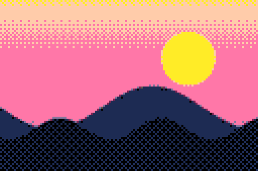
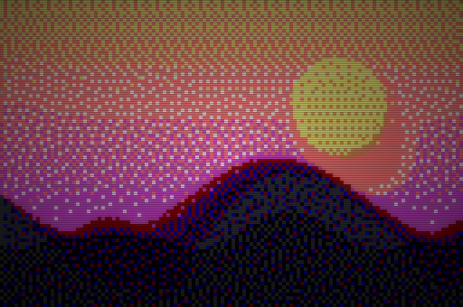

# PIXELATE

```
██████╗ ██╗██╗  ██╗███████╗██╗      █████╗ ████████╗███████╗
██╔══██╗██║╚██╗██╔╝██╔════╝██║     ██╔══██╗╚══██╔══╝██╔════╝
██████╔╝██║ ╚███╔╝ █████╗  ██║     ███████║   ██║   █████╗
██╔═══╝ ██║ ██╔██╗ ██╔══╝  ██║     ██╔══██║   ██║   ██╔══╝
██║     ██║██╔╝ ██╗███████╗███████╗██║  ██║   ██║   ███████╗
╚═╝     ╚═╝╚═╝  ╚═╝╚══════╝╚══════╝╚═╝  ╚═╝   ╚═╝   ╚══════╝
        retro pixel art from any image  ·  v2.2.0
```

[](https://www.python.org/downloads/)
[](LICENSE)
[](https://github.com/Sebby1770/pixelate/actions/workflows/ci.yml)
[](https://python-pillow.org/)

**Web lab:** [https://sebby1770.github.io/pixelate/](https://sebby1770.github.io/pixelate/)

> Turn any image (or animated GIF) into authentic retro pixel art using classic gaming palettes, **CIELAB (CIE76) matching**, serpentine error diffusion, auto-extracted palettes, eight dithering algorithms (including JJN), CRT glow + scanlines, indexed PNG/GIF, batch conversion, palette compare grids, and spritesheet export. Or open the static **web playground**. Or print it as ANSI art straight to your terminal.

---

## Gallery

| Source | Game Boy | PICO-8 (Bayer) | C64 + CRT |
|:---:|:---:|:---:|:---:|
|  |  |  |  |
| original | `--palette gameboy` | `--palette pico8 --dither bayer` | `--palette c64 --crt --scanlines` |

---

## Why?

Modern image filters smooth everything out. PIXELATE goes the other way — it crushes color depth down to the exact palettes used by the consoles and home computers of the 80s and 90s, dithers cleverly to preserve detail, and gives you a finished pixel-art image that looks like it shipped on a cartridge.

## Features (v2.2)

- **CIELAB matching** — nearest palette color uses CIE76 Lab by default (`--colorspace lab|rgb`).
- **Serpentine dither** — error diffusion scans odd rows right-to-left (`--no-serpentine` to disable).
- **Jarvis-Judice-Ninke** — `--dither jjn` plus floyd / atkinson / bayer / stucki / burkes / sierra / none.
- **Alpha + EXIF** — orientation is respected; transparent sources stay RGBA; spritesheets keep tile alpha.
- **Indexed PNG / locked GIF** — JPEG destinations become PNG; stills can write mode-`P` with the exact palette; GIFs share one palette (`disposal=2`).
- **Auto palette + honest `--report`** — working colors live on `result.info["pixelate_palette"]` (extracted after preprocess+resize).
- **`pixelate extract`** — dump N colors to a GIMP `.gpl` (optional `.hex`).
- **Web playground** — static `web/` lab (local FileReader, live canvas, PNG download). No build step.
- **Auto palette** — `--palette auto --colors N` extracts colors from the image (k-means or median-cut, numpy only).
- **Palette compare grid** — side-by-side collage of multiple palettes with labels.
- **Extra nearest scale** — `--scale N` for chunky display pixels after conversion.
- **Edge pre-pass** — `--edges` sharpen/emboss-lite to keep outlines.
- **Color usage report** — `--report` shows pixel counts per palette color.
- **Invert / contrast** — quick pre-quantize tweaks.
- **28+ retro palettes** — Game Boy DMG/Pocket/Color, NES, C64, VIC-20, Atari 2600, ZX Spectrum, CGA, PICO-8, Apple II, EGA, MSX, Sega Master System, DawnBringer 16, Sweetie 16, Endesga 32, Macintosh 16-color, vaporwave, Tokyo Night, cyberpunk, sunset, mono phosphor, grayscale.
- **Custom palette files** — load or write GIMP `.gpl` / `.hex` via `--palette-file`, `extract`, and `palettes --save-gpl`.
- **Animated GIF / WebP** — multi-frame inputs are auto-detected; frame durations are preserved.
- **Batch convert** — process whole directories; stills always land as `.png` (never keep `.jpg`).
- **Spritesheet export** — tile converted images into a grid.
- **CRT effects** — soft bloom + corner vignette + horizontal scanlines.
- **ASCII / ANSI mode** — render any image as colored terminal art.
- **Beautifully retro CLI** — green-on-black banner, palette previews, swatches, progress bars.
- **Clean Python API** — `pixelate_image()`, `dither_image()`, `srgb_to_lab()`, `extract_palette()`, `compare_palettes()`, and more.

## Install

```bash
git clone https://github.com/Sebby1770/pixelate.git
cd pixelate
pip install -e .
```

Dev / tests:

```bash
pip install -e ".[dev]"
pytest
```

Or just install the dependencies and run as a module:

```bash
pip install -r requirements.txt
python -m pixelate --help
```

## Usage

### Convert an image

```bash
pixelate convert photo.jpg --palette gameboy --pixel-size 96 --dither floyd
# Lab matching + serpentine are the defaults
pixelate convert photo.jpg --colorspace rgb --no-serpentine --dither jjn
```

Auto palette from the image:

```bash
pixelate convert photo.jpg --palette auto --colors 12 --dither floyd -o auto.png
pixelate convert photo.jpg --palette auto --colors 8 --extract-method median-cut
```

Crank up the retro:

```bash
pixelate convert photo.jpg \
  --palette nes \
  --pixel-size 128 \
  --dither stucki \
  --upscale 4 \
  --scale 2 \
  --edges \
  --crt --scanlines \
  --report \
  -o photo_retro.png
```

Invert + contrast:

```bash
pixelate convert photo.jpg --palette mono-green --invert --contrast 1.5
```

### Compare palettes

```bash
pixelate compare photo.jpg --palettes gameboy,nes,pico8,c64 -o compare.png
pixelate compare photo.jpg --palettes vaporwave,tokyo-night,cyberpunk,sunset --cols 2
```

### Custom palette file

```bash
pixelate convert photo.jpg --palette-file my_colors.gpl -o custom.png
pixelate convert photo.jpg --palette-file neon.hex --dither burkes
```

`.hex` files are one `RRGGBB` or `#RRGGBB` color per line. `.gpl` is the GIMP palette format.

Extract a palette from an image, or dump a built-in:

```bash
pixelate extract photo.jpg -o photo.gpl --colors 12
pixelate extract photo.jpg -o photo.gpl --hex
pixelate palettes --save-gpl pico8 -o pico8.gpl
```

Preview / session-register a file:

```bash
pixelate palettes --load my_colors.gpl
pixelate palettes --load my_colors.gpl --register-as neon
```

### Animated GIF

Animated GIF/WebP inputs are detected automatically. Output defaults to `.gif` and keeps approximate frame durations:

```bash
pixelate convert walk_cycle.gif --palette pico8 --pixel-size 64 -o walk_pixel.gif
```

### Batch convert

```bash
pixelate batch ./photos -o ./pixelated --palette vaporwave --dither sierra
pixelate batch ./sprites -o ./out --recursive --palette db16
```

### Spritesheet

Convert and tile images (files and/or a directory) into one sheet:

```bash
pixelate sheet ./frames --cols 8 -o sheet.png --palette gameboy
pixelate sheet a.png b.png c.png --cols 3 --no-convert -o stitch.png
```

### Render to ASCII

```bash
pixelate ascii photo.jpg --width 120 --ramp blocks
pixelate ascii photo.jpg --no-color -o art.txt
```

### Browse palettes

```bash
pixelate palettes          # list all built-in palettes
pixelate preview pico8     # print a color swatch
pixelate preview cyberpunk
pixelate preview sweetie16
pixelate preview macintosh
```

### Web playground

Open `web/index.html` locally (or the GitHub Pages deploy). Load an image, pick a palette / dither, tweak pixel size + upscale, toggle CRT/scanlines, download a PNG. Processing is entirely in the browser.

## CLI reference

```
pixelate convert IMAGE [OPTIONS]
  -p, --palette         built-in name or 'auto'
      --palette-file    .hex or .gpl path (overrides --palette)
      --colors          color count for auto palette (default 16)
      --extract-method  kmeans | median-cut
  -s, --pixel-size      Resolution of longest side (8–1024)
  -d, --dither          none | floyd | atkinson | bayer |
                        stucki | burkes | sierra | jjn
  -u, --upscale         1–16 (output pixels per logical pixel)
      --scale           1–32 extra nearest-neighbor upscale
      --saturation      0.0–3.0 (pre-quantize boost)
      --contrast        0.0–3.0 contrast multiplier
      --invert          Invert colors before palette
      --edges           Edge-aware sharpen pre-pass
      --crt             Apply CRT bloom + vignette
      --scanlines       Overlay horizontal scanlines
      --colorspace      lab (default, CIE76) | rgb
      --serpentine / --no-serpentine
      --report          Print color usage table
  -o, --output          Output path (JPEG suffixes become .png)

pixelate compare IMAGE [OPTIONS]
      --palettes        comma-separated names (default gameboy,nes,pico8,c64)
      --cols N          grid columns
      --no-label        hide captions
  -o, --output          collage path

pixelate batch INPUT_DIR -o OUTPUT_DIR [same convert options]
  -r, --recursive       Scan subdirectories

pixelate sheet PATH [PATH...] [OPTIONS]
  --cols N              Grid columns (default 4)
  --padding N           Gap between tiles
  --convert/--no-convert  Pixelate first (default: convert)
  -o, --output          Output spritesheet path
  [same palette/dither/etc options as convert]

pixelate ascii IMAGE [OPTIONS]
  -w, --width           Output width in characters
  -r, --ramp            dense | blocks | classic | binary | <custom>
      --color           24-bit ANSI color (default on)
      --invert          Invert ramp (light terminals)
  -o, --output          Save to .txt

pixelate extract IMAGE -o FILE.gpl [--colors N] [--hex]
pixelate palettes [--load FILE] [--register-as NAME]
                  [--save-gpl NAME -o FILE.gpl]
pixelate preview PALETTE
```

### Built-in palettes

| Name | Colors | Notes |
|------|--------|--------|
| `gameboy` | 4 | Original DMG green-yellow |
| `gameboy-pocket` | 4 | Pocket / Light |
| `gameboy-color` / `gbc` | 32 | Game Boy Color sample |
| `nes` | 16 | NES subset |
| `c64` | 16 | Commodore 64 |
| `vic20` / `vic-20` | 16 | Commodore VIC-20 |
| `atari2600` / `atari-2600` | 32 | Atari 2600 TIA subset |
| `zx` | 15 | ZX Spectrum (unique; one black) |
| `cga` | 4 | CGA Mode 4 high intensity |
| `pico8` | 16 | PICO-8 |
| `apple2` | 16 | Apple II low-res |
| `ega` | 16 | IBM EGA |
| `msx` | 15 | MSX Screen 2 (unique; one black) |
| `sms` / `master-system` | 16 | Sega Master System |
| `db16` | 16 | DawnBringer 16 |
| `sweetie16` / `sweetie-16` | 16 | Lospec Sweetie 16 |
| `endesga32` / `endesga-32` | 32 | Endesga 32 |
| `macintosh` | 16 | Apple Macintosh System 16-color |
| `vaporwave` | 12 | Aesthetic neon |
| `tokyo-night` / `tokyo` | 16 | Tokyo Night theme |
| `cyberpunk` | 16 | Neon cyberpunk night |
| `sunset` | 8 | Modern gradient |
| `mono-green` / `mono-amber` | 5 | Phosphor CRTs |
| `grayscale` | 9 | Neutral steps |

## Python API

```python
from pixelate import (
    pixelate_image,
    pixelate_animation,
    extract_palette,
    compare_palettes,
    color_usage_report,
    register_palette,
    load_palette_file,
    srgb_to_lab,
    dither_image,
    save_gpl,
    save_hex,
)

img = pixelate_image(
    "photo.jpg",
    palette="pico8",
    pixel_size=128,
    dither="jjn",
    colorspace="lab",
    serpentine=True,
    upscale=4,
    scale=2,
    edges=True,
    contrast=1.1,
    crt=True,
    scanlines=True,
)
img.save("output.png")

# Auto palette from image
auto_colors = extract_palette("photo.jpg", n=12, method="kmeans")
img = pixelate_image("photo.jpg", palette="auto", colors=12)

# Compare collage
grid = compare_palettes("photo.jpg", ["gameboy", "nes", "pico8", "c64"])
grid.save("compare.png")

# Color usage after convert
report = color_usage_report(img, palette=auto_colors)
for color, count, pct in report:
    print(color, count, f"{pct:.1f}%")

# Custom palette file
img = pixelate_image("photo.jpg", palette_file="my.gpl", dither="burkes")

# Or register for reuse
register_palette("neon", load_palette_file("neon.hex"))
img = pixelate_image("photo.jpg", palette="neon")

# Animation
from pixelate import pixelate_animation
pixelate_animation("walk.gif", palette="gameboy", output="walk_pixel.gif")
```

```python
from pixelate.ascii_art import image_to_ascii

print(image_to_ascii("photo.jpg", width=80, ramp="blocks", color=True))
```

```python
from pixelate.core import make_spritesheet, collect_images, pixelate_image
from PIL import Image

paths = collect_images(["./sprites"])
tiles = [pixelate_image(p, palette="db16", pixel_size=32, upscale=2) for p in paths]
sheet = make_spritesheet(tiles, cols=8)
sheet.save("sheet.png")
```

## How it works

1. **Pre-process (optional)** — invert, contrast, saturation, edge-aware sharpen.
2. **Resize** — the source image is downsampled with Lanczos to a low resolution (you control this — `pixel_size`). This is the actual "pixelation."
3. **Palette** — built-in name, custom file, RGB sequence, or **auto** extract via k-means / median-cut.
4. **Quantize** — every pixel is matched against the chosen palette using CIE76 Lab (default) or Euclidean RGB.
5. **Dither** — quantization error is spread with serpentine kernels (Floyd-Steinberg, Atkinson, Stucki, Burkes, Sierra, JJN) or hidden in a Bayer pattern.
6. **Upscale** — the small image is enlarged with nearest-neighbor so the pixels stay crisp and chunky (`upscale`, then optional extra `--scale`).
7. **Effects (optional)** — scanlines and a CRT-style bloom-plus-vignette pass.
8. **Animation** — multi-frame sources run the pipeline per frame, then reassemble with original durations.

## Tests & CI

```bash
pip install -e ".[dev]"
pytest
```

GitHub Actions runs pytest on Python 3.9–3.13 (see `.github/workflows/ci.yml`). The playground is published from `web/` via `.github/workflows/pages.yml`.

## Project layout

```
pixelate/
├── pixelate/
│   ├── __init__.py
│   ├── __main__.py
│   ├── cli.py          # Click CLI (convert, compare, batch, sheet, extract, ascii, palettes)
│   ├── core.py         # Conversion pipeline, auto palette, compare, report, indexed I/O
│   ├── colorspace.py   # sRGB → Lab, nearest-palette indices
│   ├── animation.py    # Multi-frame GIF/WebP (shared P palette)
│   ├── palette_io.py   # .hex / .gpl load + save + register_palette
│   ├── palettes.py     # Built-in retro palettes
│   ├── dithering.py    # FS, Atkinson, Bayer, Stucki, Burkes, Sierra, JJN
│   ├── effects.py      # CRT, scanlines, vignette
│   ├── ascii_art.py    # ASCII / ANSI rendering
│   └── ui.py           # Rich-styled banner + tables
├── web/                # Static playground (GitHub Pages)
├── tests/
├── .github/workflows/ci.yml
├── .github/workflows/pages.yml
├── pyproject.toml
├── requirements.txt
├── CHANGELOG.md
├── LICENSE
└── README.md
```

## Roadmap

- [x] Animated GIF input/output
- [x] Custom palette files (.gpl / .hex)
- [x] Sprite sheet export
- [x] More dithering kernels (Stucki, Burkes, Sierra)
- [x] Batch convert
- [x] More built-in palettes (EGA, MSX, SMS, DB16, vaporwave, GBC, VIC-20, Atari, Tokyo Night, cyberpunk)
- [x] Palette extraction from source images
- [x] Multi-palette compare collage
- [x] Color usage report
- [x] Web playground
- [x] Optional LAB / perceptual color distance (CIE76, default)

## License

MIT — see [LICENSE](LICENSE).

## Author

Made by [Seb (Sebby1770)](https://github.com/Sebby1770).
